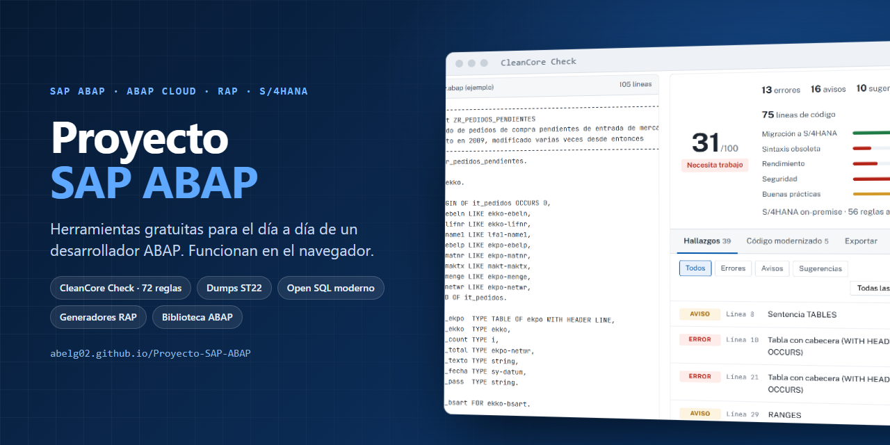
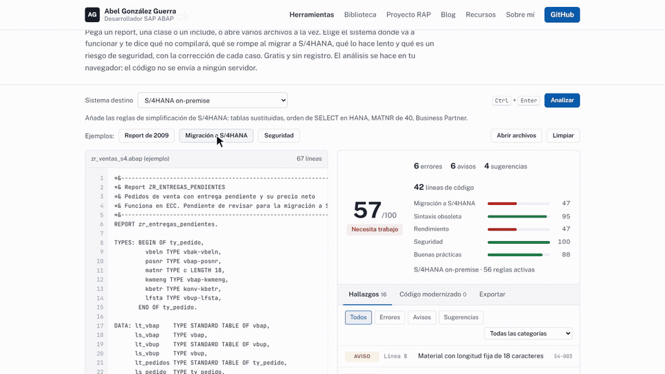

<p align="center">
  
</p>

<h1 align="center">Proyecto SAP ABAP</h1>

<p align="center">
  Herramientas gratuitas para el día a día de un desarrollador SAP ABAP, una biblioteca de clases de código abierto y artículos técnicos.<br>
  Todo funciona en el navegador: el código que analizas no sale de tu ordenador.
</p>

<p align="center">
  <a href="https://abelg02.github.io/Proyecto-SAP-ABAP/"><b>Abrir la web</b></a> ·
  <a href="https://abelg02.github.io/Proyecto-SAP-ABAP/herramientas/cleancore-check.html">CleanCore Check</a> ·
  <a href="biblioteca/">Biblioteca ABAP</a>
</p>

<p align="center">
  <a href="https://github.com/abelg02/Proyecto-SAP-ABAP/actions/workflows/pages.yml"></a>
  
  
</p>

<p align="center">
  
</p>

## Herramientas

| Herramienta | Qué hace |
|---|---|
| **CleanCore Check** | Analiza código ABAP con 72 reglas para 6 sistemas: ECC 7.0x, ECC 7.40/7.50, S/4HANA on-premise, Private Edition, Public Edition y BTP. Revisa compatibilidad de versión, migración a S/4HANA (VBUK, KONV, MATDOC, ACDOCA, MATNR de 40, ORDER BY en HANA, Business Partner…), ABAP Cloud, rendimiento, seguridad y buenas prácticas. Da una nota de 0 a 100, la corrección de cada hallazgo, moderniza el código según la versión y exporta el informe en Markdown, CSV o PDF. |
| **Explicador de dumps ST22** | Pegas el dump, en español o en inglés, y explica el error, sus causas, cómo analizarlo y la corrección en código. Cubre 50 errores frecuentes. |
| **Conversor de Open SQL** | Pasa los SELECT antiguos a la sintaxis estricta (@, comas, FIELDS) con avisos de rendimiento. |
| **Formateador ABAP** | Pretty Printer en el navegador. |
| **Referencia** | Transacciones, funciones y BAPIs con su sustituto en ABAP Cloud, y tablas con su vista CDS liberada. |
| **Timestamps y fechas** | TIMESTAMP, DATS, Unix, ISO y zonas horarias con su código ABAP, y calculadora de días laborables. |
| **Generadores** | BO RAP con draft (9 objetos), report ALV, tests ABAP Unit, clase de excepción T100 y tipos desde JSON. |

## Biblioteca ABAP Toolkit

En [`biblioteca/`](biblioteca/) hay 20 objetos y una plantilla RAP managed con draft, en dos versiones: **ABAP Cloud** y **ABAP clásico (7.4+)**. La licencia es MIT y se pueden descargar en ZIP desde la web o importar con abapGit.

> Está escrita con APIs liberadas y sintaxis moderna, y pasa su propio CleanCore Check con 99-100, pero todavía no se ha activado en un sistema SAP real.

## Calidad

- 60 tests del motor de análisis y 17 del conversor de SQL (`npm test`).
- Prueba completa en Chrome de las 19 páginas y todas las herramientas, sin errores de JavaScript (`npm run probar`).
- 0 enlaces rotos (`npm run enlaces`) y 0 datos personales o secretos en lo que se publica (`npm run privacidad`).
- GitHub Actions pasa los tests, los enlaces y la privacidad antes de cada publicación.

## Estructura

| Carpeta | Contenido |
|---|---|
| [`web/`](web/) | La web publicada: 19 páginas, 7 herramientas, descargas y PDF |
| [`web-fuente/`](web-fuente/) | Fuente de las páginas, plantilla común y configuración |
| [`biblioteca/`](biblioteca/) | Código de ABAP Toolkit (Cloud y clásico) |
| [`documentos/`](documentos/) | Fuente y PDF de la chuleta de ABAP moderno y del CV |
| [`curso/`](curso/) | Temario de una serie gratuita de vídeos de ABAP Cloud y RAP |
| [`scripts/`](scripts/) | Tests, comprobación de enlaces y privacidad, capturas y empaquetado |

## Uso en local

Requiere Node 18 o superior. Para `npm run probar` y los PDF, también Chrome.

```bash
npm install
npm run build      # regenera la web desde web-fuente/
npm test           # tests del motor y del conversor de SQL
npm run probar     # prueba toda la web en Chrome
npm run todo       # build, tests, PDF, enlaces, empaquetado y privacidad
```

La web es estática: basta con abrir `web/index.html` o servir la carpeta `web/`.

## Autor

**Abel González Guerra** · Desarrollador SAP ABAP · [github.com/abelg02](https://github.com/abelg02)
